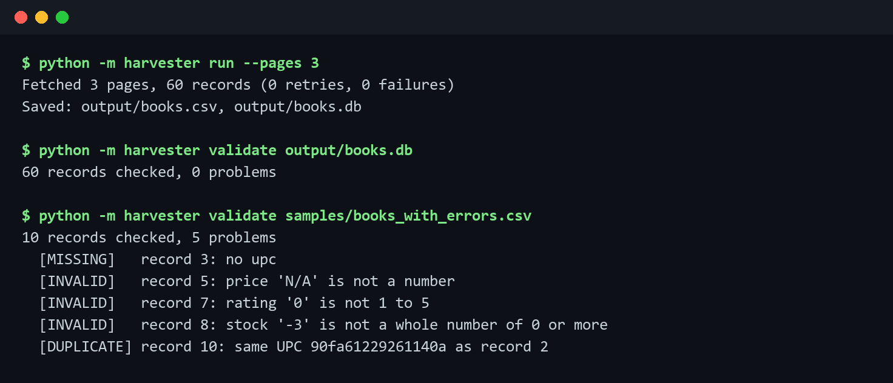

# web-data-harvester

[](https://github.com/Ash86-cpu/web-data-harvester/actions/workflows/tests.yml)



A Python bot that collects product data from a website, saves it to CSV and
SQLite, and checks every record for data quality problems before anyone
relies on it.

It runs against [books.toscrape.com](https://books.toscrape.com), a public
site built for scraping practice: 1,000 books across 50 catalogue pages, each
with a title, price, stock count, star rating, UPC and category.

The two halves mirror a real data pipeline: **harvest** (fetch pages
reliably, parse them, store the results) and **validate** (catch missing,
invalid and duplicate records, and fail loudly with a non-zero exit code so
a scheduler or CI job notices).

## Quick start

Requires Python 3.10+.

```
git clone https://github.com/Ash86-cpu/web-data-harvester.git
cd web-data-harvester
pip install -r requirements.txt

python -m harvester run --pages 3
python -m harvester validate output/books.db
```

## Example output

```
$ python -m harvester run --pages 3
Fetched 3 pages, 60 records (0 retries, 0 failures)
Saved: output/books.csv, output/books.db

$ python -m harvester validate output/books.db
60 records checked, 0 problems

$ python -m harvester validate samples/books_with_errors.csv
10 records checked, 5 problems
  [MISSING]   record 3: no upc
  [INVALID]   record 5: price 'N/A' is not a number
  [INVALID]   record 7: rating '0' is not 1 to 5
  [INVALID]   record 8: stock '-3' is not a whole number of 0 or more
  [DUPLICATE] record 10: same UPC 90fa61229261140a as record 2
```

The live site is clean, so `samples/books_with_errors.csv` is real harvested
data with five problems added on purpose, to show what each check reports.

## Options

| Command | Option | Meaning |
|---|---|---|
| `run` | `--pages N` | Catalogue pages to fetch, 20 books each (default 1) |
| | `--out DIR` | Folder for `books.csv` and `books.db` (default `output`) |
| | `--delay S` | Seconds between requests (default 0.5) |
| `validate` | `PATH` | A `.db` or `.csv` file from `run` |
| | `--json` | Machine-readable output |
| both | `-v` | Log retries and failures |

Exit codes: `run` returns 2 if any page failed after retries. `validate`
returns 1 if it found problems, 0 if the data is clean.

## How it works

```
catalogue page -> parse_list() -> book links -> fetch each -> parse_book() -> Book records
                                                                              |
                                  books.csv + books.db  <-  save_csv / save_sqlite
                                                                              |
                                                     validate() -> problems + exit code
```

| File | Responsibility |
|---|---|
| `harvester/fetch.py` | `Fetcher`: timeouts, retries with exponential backoff, polite delay, failure tracking |
| `harvester/parse.py` | Catalogue and book page parsing with BeautifulSoup |
| `harvester/store.py` | CSV and SQLite output, and loading either back |
| `harvester/validate.py` | One function per data quality rule |
| `harvester/__main__.py` | Command-line interface |

Design decisions:

- **Retry what can recover, give up on what cannot.** Network errors, 429
  and 5xx responses are retried after 1 s, 2 s and 4 s. A 404 is not
  retried, because waiting will not make the page appear.
- **One bad page does not stop the run.** A book page that still fails is
  counted, logged and skipped; the summary line and exit code report it.
- **Be polite to the site.** A delay between requests and an identifying
  User-Agent keep the load low and make the bot easy to recognise.
- **Keep bad values, do not hide them.** The parser stores what the page
  says (for example a price of `N/A`) instead of dropping it, so the
  validator can report it. Duplicate UPCs are stored too, for the same
  reason.
- **Tests never touch the network.** They run against saved copies of real
  pages and a fake HTTP session, so they are fast and repeatable.

## Checks

| Kind | Rule |
|---|---|
| MISSING | UPC, title, price and URL must be present |
| INVALID | Price must be a number and not negative |
| INVALID | Rating must be 1 to 5 |
| INVALID | Stock must be a whole number, 0 or more |
| DUPLICATE | Each UPC appears once; the report points to the first record |

## Tests

```
pip install -r requirements-dev.txt
python -m pytest -v
```

28 tests cover parsing (including missing and malformed pages), fetching
(retries, backoff timing, giving up, no retry on 404, polite delay), every
validation rule, CSV and SQLite round trips, and an end-to-end run of the
command-line tool against a fake two-page site. They run on every push with
GitHub Actions.

## Limitations

- Parsing is written for books.toscrape.com's HTML. Another site needs its
  own `parse.py`.
- Pages are fetched one at a time. That is deliberate for a practice site,
  but a large job would want a bounded worker pool.
- It does not run JavaScript, so pages that build their content in the
  browser would need a browser automation tool.

## License

MIT
